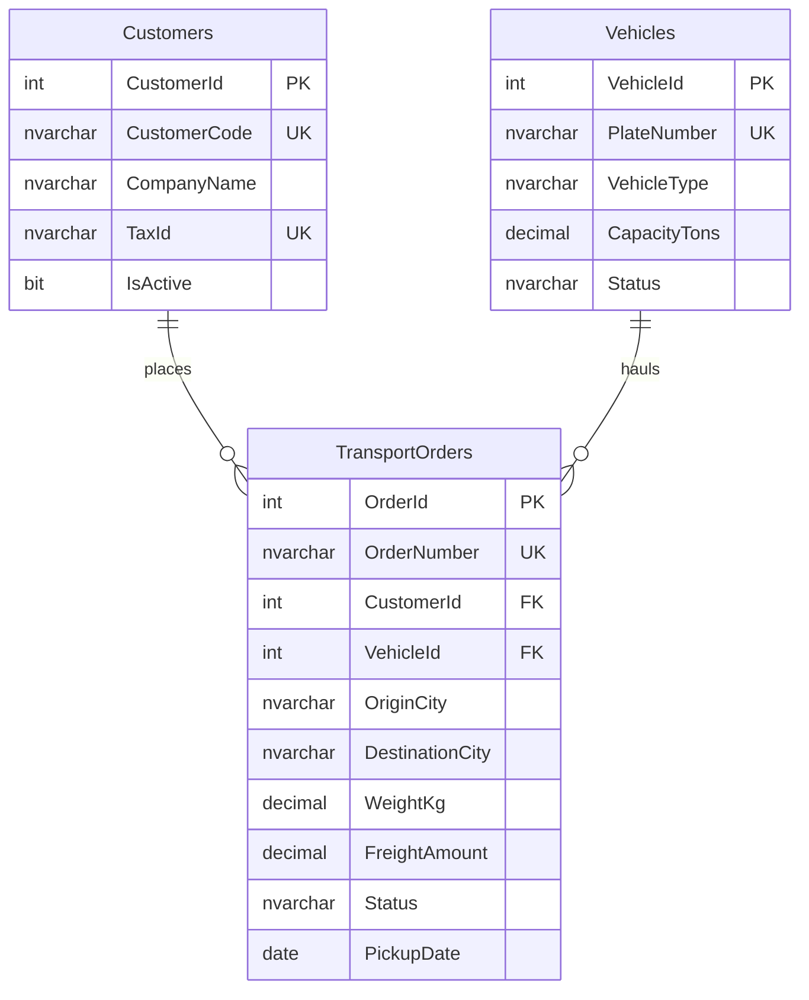
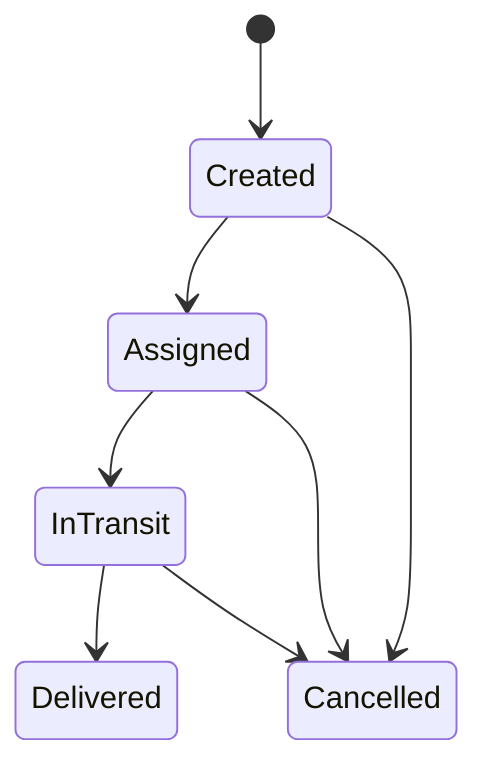

# Transport order management sample

## Purpose

Provide a small SQL Server database for carrier-line order handling: customers who buy freight, vehicles that move it, and the transport orders that connect them.

## Scope

The sample creates the `TransportOrders` database, three tables, five rows in each table, and stored procedures for create, read, update, and delete. It does not include authentication, billing, multi-stop routes, drivers, or a user interface.

## Business impact

Dispatchers can practice registering a customer, assigning a vehicle, and moving an order from creation through delivery. The data is fictional and is meant for local development and training.

## Key decisions

- Three tables keep the model inside the requested size. Order status and vehicle status are constrained strings, so no lookup tables were added.
- Identifiers and procedure names are in English. Sample company names and cities are Spanish because the scenario is a Mexican carrier line.
- Reads of an order join the customer and the vehicle so a single call returns the dispatch view.
- Deletes are physical. A customer or vehicle delete is rejected while an order still references it.
- Create and update enforce assignment rules. They do not enforce a strict status sequence, so a correction can set any allowed status directly.
- When an order becomes `InTransit`, the assigned vehicle becomes `InTransit`. When that vehicle no longer has an order in transit, the procedure sets it back to `Available`.

## Data model

The diagram shows the intended operational flow. The procedures accept any status from the allowed list and do not reject a jump, such as `Created` directly to `Delivered`, as long as the other rules pass.

## Assumptions and limitations

- SQL Server 2016 SP1 or later is required because the scripts use `CREATE OR ALTER` and `DROP TABLE IF EXISTS`.
- Currency is limited to `MXN` and `USD`.
- Weight is stored in kilograms and vehicle capacity in tons. The procedures compare them directly.
- Vehicle status returns to `Available` only from `InTransit`. A vehicle left in `Maintenance` stays there.
- Re-running `02_create_tables.sql` drops the tables and their rows. Re-running `03_seed_data.sql` replaces the sample rows. Identity values increase if the seed script is run without recreating the tables.
- There is no audit history beyond `CreatedAt` and, on orders, `UpdatedAt`.
